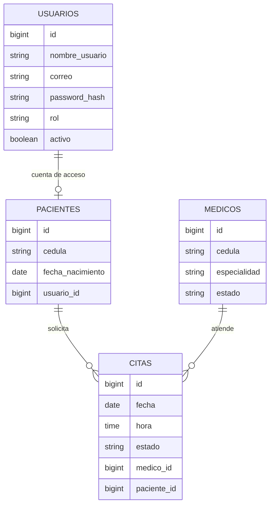

# Arquitectura de Clínica Piedra Azul

Universidad del Cauca · Laboratorio de Ingeniería del Software III

La aplicación separa la interfaz de la API. Angular no decide quién puede ver un dato: Spring Security lo decide en cada petición. El navegador solo usa el token para mostrar el menú que corresponde al rol.

## Capas del backend

El código vive en `com.piedraazul`.

| Paquete | Responsabilidad |
| --- | --- |
| `controller` | Traduce HTTP a una llamada de servicio. No consulta la base. |
| `dto` | Contratos de entrada y salida. Los de entrada llevan validación. |
| `service` | Reglas: cédula única, horario del médico, citas del usuario autenticado. |
| `repository` | Consultas Spring Data JPA. |
| `entity` | Tablas y relaciones. |
| `security` | JWT, filtro y usuario de Spring Security. |
| `config` | CORS, cadena de seguridad, verificación de MySQL y datos iniciales. |
| `exception` | Convierte fallos de negocio y de validación en JSON con el código HTTP correcto. |

Una petición privada recorre el filtro JWT, la regla de `SecurityConfig`, el controlador, el servicio y el repositorio. La respuesta vuelve como un DTO, nunca como la entidad con el hash de la contraseña.

## Modelo de datos

`usuarios.correo` y `usuarios.nombre_usuario` son únicos. `medicos.cedula` y `pacientes.cedula` también, y el servicio `CedulaService` revisa las dos tablas antes de registrar. `citas` tiene la restricción `uk_cita_medico_horario` sobre médico, fecha y hora. Los roles y estados se guardan como texto (`ADMIN`, `PACIENTE`, `PROGRAMADA`, `ATENDIDA`, `CANCELADA`, `ACTIVO`, `INACTIVO`).

El paciente tiene una cuenta `Usuario` de uno a uno. El médico no inicia sesión: lo administra el rol `ADMIN`.

## Seguridad

La sesión es stateless. No hay cookies de sesión, CSRF, login de formulario ni usuario anónimo. El filtro JWT, registrado una sola vez como `@Bean`, lee `Authorization: Bearer`. Si el token falta o la firma no coincide, la ruta privada termina en 401. Si el token es válido y el rol no alcanza, el `AccessDeniedHandler` escribe JSON 403.

El orden de las reglas importa. `GET /api/citas/mis-citas` exige `PACIENTE` y está antes de la regla general de `/api/citas`. Las colecciones `/api/medicos` y `/api/pacientes` se protegen con la ruta exacta y con `/**`, porque el comodín no cubre la URL de la colección.

| Petición | Quién pasa |
| --- | --- |
| `POST /api/auth/login` | Público |
| `GET /api/salud` | Público |
| `GET /api/medicos/publicos` | Público. Solo id, nombres, apellidos y especialidad de médicos activos. |
| `GET /api/auth/yo` | Cualquier token válido |
| `/api/medicos` y `/api/pacientes` | `ADMIN` |
| `POST` y `GET /api/citas` | `ADMIN` |
| `GET /api/citas/mis-citas` | `PACIENTE`. El correo sale del token. |

El login usa el correo en minúsculas y BCrypt. Una cuenta inactiva también responde 401, con un mensaje distinto al de la contraseña incorrecta. El secreto HMAC está en `app.jwt.secret`, fuera de Git, y el servicio rechaza un secreto de menos de 32 caracteres. El token dura dos horas y lleva `sub` (correo), `rol` y `uid`.

## Frontend

Angular 22 está organizado con Atomic Design:

- Átomos: botón, campo, etiqueta, selector, insignia, alerta, carga y tabla.
- Moléculas: sección de tabla (título, resumen y tabla) y tarjeta de estadística.
- Organismos: encabezado, menú, pie, formulario de ingreso, formularios de médico, paciente y cita, y los tres listados.
- Plantillas: una pública y una con menú lateral.
- Páginas: ingreso, directorio, panel, gestión y mis citas.

La tabla es el átomo reutilizable. Médicos, pacientes y citas cambian las columnas, no el marcado de la tabla. Bajo 800 px el menú lateral pasa a una fila horizontal y los formularios de dos columnas pasan a una.

Hay dos guardias distintas. `AuthGuard` exige un token vigente y, si no lo hay, abre `/ingreso`. `RoleGuard` compara el rol del token con `data.roles` y, si no coincide, abre `/panel?aviso=sin-permiso`. El interceptor agrega `Bearer` solo cuando la URL no está en `RUTAS_PUBLICAS`. Ante un 401 de una ruta privada limpia el token y va a `/ingreso`, excepto si la petición ya era el login. Ante un 403 muestra un aviso y no redirige en círculo.

La aplicación no usa Zone.js. Las listas consumen los observables con `async`. El formulario de citas convierte las listas de pacientes y médicos en señales con `toSignal`, para que los selectores se pinten cuando llega la respuesta.

Los formularios son reactivos. La cédula usa un validador asíncrono con `debounceTime(400)`, `distinctUntilChanged` y `switchMap`: espera a que la persona deje de escribir, no repite la misma consulta y cancela la anterior si el número cambia. Si la cédula ya está en médicos o en pacientes, el campo muestra “Esta cédula ya está registrada” y el botón permanece deshabilitado.

El token se guarda en `sessionStorage` con la clave `cpa_token`. El rol que arma el menú se lee del payload para la experiencia de navegación. La firma la comprueba el backend en cada petición privada.

## Directorio público y pacientes

La primera página de la guía pide un listado público de médicos. Las reglas de rol reservan el registro y la consulta de pacientes al administrador, y “mis citas” al paciente autenticado. Una tabla posterior marca “listar pacientes” como público y como administrador. El sistema sigue la primera regla y la protección de datos: `GET /api/pacientes` sin token responde 401 y con token de paciente responde 403. El directorio público no incluye cédula, teléfono, correo ni dirección.

## Arranque

`VerificacionConexion` abre una conexión JDBC real. Si MySQL niega el acceso, la aplicación se detiene. El dialecto de MySQL queda declarado para que Hibernate pueda iniciar, y esa verificación evita que un fallo de clave se quede solo como advertencia. `DatosIniciales` corre después y solo inserta la carga de laboratorio cuando el correo del administrador todavía no existe.
